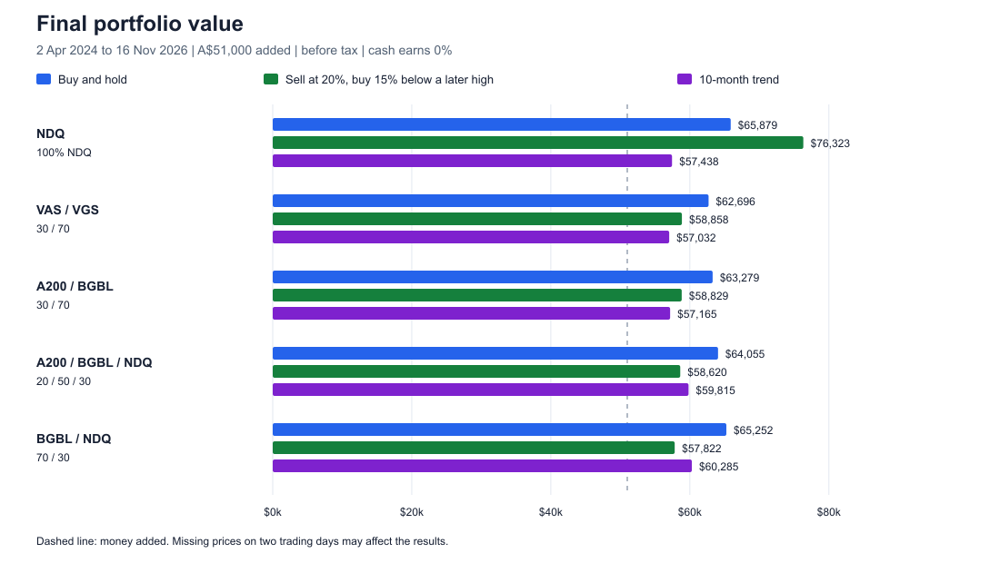

# ETF backtests

> **The takeaway:** holding finished ahead in most comparisons. Taking profits and buying a dip sometimes helped, but we did not find a trading rule that won across both periods and all five portfolios.

We compared regular ETF investing with profit targets, dip-buying rules and a simple trend rule. Each strategy gets the same money, pays trading costs and uses actual ETF history.

- **Holding finished ahead in all five portfolios from May 2023, and four of five from April 2024.**
- **Buying 15% below the sale value left all five May 2023 accounts waiting in cash.** Other starting dates did lead to buying back.
- **Buying 15% below a later high helped NDQ in the April 2024 test.** It finished behind holding from May 2023, so the starting date matters.
- **The 10-month trend rule finished with less money than holding in both shared periods.** It reduced the biggest falls in some portfolios.

## A quick look at the results

**2 April 2024 to 16 November 2026.** This start gives every portfolio enough history for the trend rule. Each account starts with **A$20,000**, adds **A$1,000 a month** and receives **A$51,000 in total**. Cash earns 0%.



| Portfolio (weights %) | Hold | 20% exit / 15% peak drop | 10-month trend |
| --- | --- | --- | --- |
| NDQ | $65,879 | $76,323 | $57,438 |
| VAS / VGS (30/70) | $62,696 | $58,858 | $57,032 |
| A200 / BGBL (30/70) | $63,279 | $58,829 | $57,165 |
| A200 / BGBL / NDQ (20/50/30) | $64,055 | $58,620 | $59,815 |
| BGBL / NDQ (70/30) | $65,252 | $57,822 | $60,285 |

All amounts are AUD and include the money added. Values include trading costs and estimated selling costs at the end. Tax is excluded. These accounts start fresh in April 2024; earlier gains are not carried forward.

**There are trade-offs.** NDQ's peak-drop rule ended at **$76,323**, with a biggest recorded fall of **10.9%**, versus **$65,879** and **21.4%** for holding. From May 2023, that rule ended at **$91,234**, below holding's **$96,362**. One good starting date is not enough to call it a better strategy.

## BGBL / NDQ allocation comparison

We also compared three buy-and-hold allocations to test whether increasing Nasdaq-100 exposure improved outcomes. These use the existing backtest engine, actual ETF history, A$20,000 initially, A$1,000 monthly, and the same trading-cost and distribution assumptions. The accounts are **before tax** and cash earns 0%.

### 12 May 2023 to 16 November 2026

Each account received **A$62,000** in total.

| BGBL / NDQ allocation | Final value | Profit | Annualised money-weighted return | Maximum drawdown |
| --- | ---: | ---: | ---: | ---: |
| 70% / 30% | A$92,108 | A$30,108 | 17.7% | −16.0% |
| 50% / 50% | A$93,377 | A$31,377 | 18.4% | −17.4% |
| 30% / 70% | **A$94,584** | **A$32,584** | **19.0%** | **−18.9%** |

The 70%-NDQ allocation finished **A$2,476 ahead** of 30%-NDQ, with a maximum drawdown approximately **2.9 percentage points deeper**.

### 2 April 2024 to 16 November 2026

Each account received **A$51,000** in total.

| BGBL / NDQ allocation | Final value | Profit | Annualised money-weighted return | Maximum drawdown |
| --- | ---: | ---: | ---: | ---: |
| 70% / 30% | A$65,252 | A$14,252 | 14.2% | −16.0% |
| 50% / 50% | A$65,498 | A$14,498 | 14.4% | −17.4% |
| 30% / 70% | **A$65,627** | **A$14,627** | **14.5%** | **−18.9%** |

The 70%-NDQ allocation finished just **A$375 ahead** of 30%-NDQ for this later start, despite the larger observed drawdown. Increasing NDQ exposure therefore improved final values in both tested periods, but the magnitude depended heavily on the start date.

**What this does not establish:** BGBL already includes large US technology companies held by NDQ, so raising NDQ increases concentration rather than adding an independent asset class. BGBL's short live history limits the comparison; these are overlapping historical periods, not independent long-term evidence. Two missing trading sessions may affect reported drawdowns. The study excludes personal tax, inflation and future changes in market leadership.

[Allocation results CSV](results/allocation_comparison.csv) · [Methodology](docs/methodology.md)


## NDQ weekly buy-and-hold: buying extra during dips

This separate study starts with **A$0** and buys **A$500 of NDQ each week**. The dip variants add **A$100 in every qualifying week** when the *previous session's closing price* is at least 5%, 10% or 15% below the highest close over the preceding **30 trading sessions**. Purchases execute at the first available trading-session open of the week; there are **no sales**. Distributions are included, with A$5 brokerage per buy and 0.05% slippage. All figures are in AUD, before personal tax.

### Full NDQ history: 2 June 2015 to 16 November 2026

| Weekly strategy | Total contributed | Extra dip weeks | Final value | Investment profit | Annualised money-weighted return | Maximum drawdown |
| --- | ---: | ---: | ---: | ---: | ---: | ---: |
| A$500 DCA only | A$299,500 | 0 | A$969,198 | A$669,698 | 19.26% | −30.96% |
| **DCA + A$100 at −5%** | **A$311,800** | **123** | **A$1,008,026** | **A$696,226** | **19.29%** | **−30.96%** |
| DCA + A$100 at −10% | A$302,400 | 29 | A$977,219 | A$674,819 | 19.27% | −30.96% |
| DCA + A$100 at −15% | A$299,600 | 1 | A$969,542 | A$669,942 | 19.26% | −30.96% |

The −5% rule produced **A$38,828 more final wealth** than baseline DCA, but required **A$12,300 more contributions**. Its **A$26,528 additional investment profit** came with only about **0.03 percentage points** higher annualised money-weighted return. Drawdowns were essentially unchanged. A larger final balance is not, by itself, evidence that the dip timing is better than simply investing the extra cash regularly.

### Shorter-period checks

| Period | DCA-only profit | −5% dip profit | −10% dip profit | −15% dip profit |
| --- | ---: | ---: | ---: | ---: |
| 12 May 2023 – 16 Nov 2026 | A$29,370 | **A$30,213** | A$29,529 | A$29,370 |
| 2 Apr 2024 – 16 Nov 2026 | A$12,770 | **A$13,367** | A$12,917 | A$12,770 |

The −15% condition did not trigger at all in either shorter period. The 30-session rolling-high reference can move lower during prolonged downturns, so this rule is **not** equivalent to a decline from NDQ's all-time high. The periods overlap and are not independent observations. Two missing trading sessions were excluded; the study does not include tax or inflation. A **budget-matched fixed-weekly contribution** comparison would be a useful next test to isolate the value of dip timing.

[Weekly NDQ results CSV](results/ndq_weekly_dip_backtest.csv) · [Backtest script](scripts/ndq_weekly_dip.py) · [GitHub Actions workflow](.github/workflows/ndq-weekly-dip.yml)

## Read each backtest

| Backtest | What we learned |
| --- | --- |
| [1. Sell at 15% or 20%, then stay in cash](docs/01-profit-targets/README.md) | Less time in shares meant less money at the end of the May 2023 comparison. |
| [2. Buy back 15% below the sale value](docs/02-fixed-reentry/README.md) | The price rule could leave an account in cash for years. |
| [3. Buy after a 15% fall from the later high](docs/03-peak-reentry/README.md) | More chances to buy back, with results that changed by portfolio and start date. |
| [4. Follow the 10-month trend](docs/04-monthly-trend/README.md) | Some smaller falls, but less money at the end in both shared periods. |

**These results have limits.** Prices are missing for two trading days, which may affect trades and reported losses. Some ETFs have short histories. The tests are before tax and do not tell us what will happen next. [See the assumptions and data limits](docs/methodology.md).

## Run it yourself

Python 3.10+ and `curl` are enough. The saved data is included, so these commands work offline:

```sh
python3 -m unittest discover -s tests -v
python3 -m etf_backtest tactical
python3 -m etf_backtest validate-tactical
```

[Setup, all run commands and outputs](docs/running.md) · [How the tests work](docs/methodology.md)

The saved checks passed **39 tests** and checked **33,940 scenarios** in the latest comparison. The earlier two studies each contain 20,316 scenarios. These studies reuse accounts and periods, so those counts are not independent pieces of evidence.
