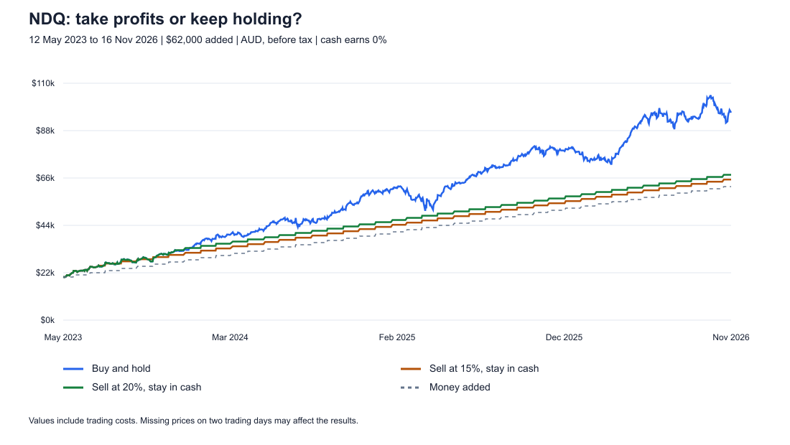

# 1. Take profits, then stay in cash

> **TL;DR:** holding ended with more money than either profit target in all five portfolios in the May 2023 comparison. Selling avoided later price swings, but the accounts missed later gains.

[Overview](../../README.md) · [How the tests work](../methodology.md) · [Run the project](../running.md)

## What we tested

Start on **12 May 2023** and finish on **16 November 2026**. Each account starts with A$20,000 and adds A$1,000 a month from the following month, for **A$62,000 added in total**. Cash earns 0%.

| Rule | What happens after selling? |
| --- | --- |
| Buy and hold | Keep investing. There is no profit target. |
| Sell at a 15% gain | Sell everything, then keep the proceeds and later deposits in cash. |
| Sell at a 20% gain | The same, with a higher target. |

A gain is measured against the money added to the account. New deposits are capital, not profit. Signals use the closing price; sales happen at the next available open. A price gap can leave the actual sale below the target.

## What happened



| Portfolio | Hold | Sell at 15% | Sell at 20% |
| --- | --- | --- | --- |
| NDQ | $96,362 | $65,280 | $67,488 |
| VAS / VGS (30/70) | $85,833 | $66,475 | $69,007 |
| A200 / BGBL (30/70) | $86,415 | $66,222 | $69,102 |
| A200 / BGBL / NDQ (20/50/30) | $89,261 | $66,365 | $67,843 |
| BGBL / NDQ (70/30) | $92,108 | $66,200 | $68,163 |

Values are AUD, before tax, after trading costs and estimated selling costs at the end. [Portfolio weights](../methodology.md#portfolios) are the same in every study.

### NDQ in more detail

| Rule | Final value | Profit | Annual return* | Biggest fall* | Days to target | Sale date |
| --- | --- | --- | --- | --- | --- | --- |
| Hold | $96,362 | $34,362 | 19.8% | -21.3% | Not used | No sale |
| Sell at 15% | $65,280 | $3,280 | 2.2% | -3.0% | 68 | 2023-07-20 |
| Sell at 20% | $67,488 | $5,488 | 3.7% | -7.4% | 215 | 2023-12-14 |

*Annual return means the money-weighted return, which accounts for the dates of deposits. Biggest fall means the largest fall in the account's value after adjusting for deposits. These are historical results, not loss limits.*

## What to take from this

The lower target took money out of shares sooner. The higher target stayed invested longer. Both missed later gains on this market path. A profit target also does nothing to protect against a fall **before** the account reaches that target.

This is one shared period, not a rule for every market. The saved results also test annual starts, monthly 3, 6, 12 and 24-month periods, and quarterly 3 and 5-year periods where actual ETF history exists.

### What if the target never arrives?

These separate accounts ran from **4 January to 30 December 2022**. Neither reached the 20% target. They stayed invested through the losses.

| Portfolio | Money added | Final value | Profit | Biggest fall | Sales |
| --- | --- | --- | --- | --- | --- |
| NDQ | $31,000 | $23,801 | -$7,199 | -31.0% | 0 |
| VAS / VGS (30/70) | $31,000 | $28,804 | -$2,196 | -18.4% | 0 |

A take-profit rule is not a stop-loss rule.

**Keep in mind:** two missing trading days may change signals, trade dates and the biggest recorded fall. Results are before tax. They do not tell us what markets will do next.

## Check the details

[Full saved report](../../results/report.md) · [Every account and metric](../../results/trials.csv) · [Other start dates](../../results/summary.csv) · [Trade log](../../results/trade_ledger.csv) · [Validation](../../results/validation.json)

To repeat this study:

```sh
python3 -m etf_backtest run
python3 -m etf_backtest validate
```

[Next: buying back below the sale value](../02-fixed-reentry/README.md)
