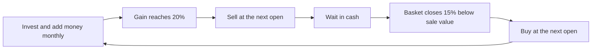
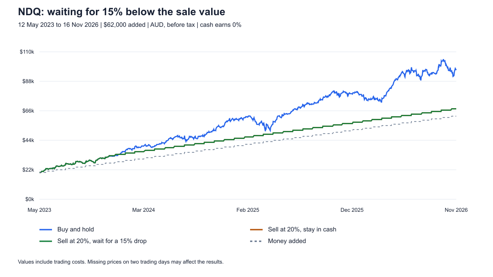

# 2. Buy back below the sale value

> **TL;DR:** none of the five accounts starting in May 2023 bought back in. Their reference baskets never fell 15% below the sale value. Some other starting dates did lead to buying back, so this was not true of the whole history.

[Overview](../../README.md) · [How the tests work](../methodology.md) · [Run the project](../running.md)

## The rule



We track the same units that were sold, including later distributions and split changes. Deposits into the real cash account do not move the reference. When buying back, invest the available cash and reset the next 20% target to that account value.

**Simple example, ignoring costs and distributions:** buy at 100, sell at 120, then wait for 102. If the market rises to 160 and falls to 136, it is down 15% from the high but still does not meet this rule.

## The May 2023 accounts stayed in cash

**12 May 2023 to 16 November 2026. A$62,000 added per account. Cash earns 0%.**



*The two selling lines overlap because this NDQ account never bought back.*

| Portfolio | Hold | Buy below sale | Sales | Times bought back | Days still waiting |
| --- | --- | --- | --- | --- | --- |
| NDQ | $96,362 | $67,488 | 1 | 0 | 1068 |
| VAS / VGS (30/70) | $85,833 | $69,007 | 1 | 0 | 852 |
| A200 / BGBL (30/70) | $86,415 | $69,102 | 1 | 0 | 852 |
| A200 / BGBL / NDQ (20/50/30) | $89,261 | $67,843 | 1 | 0 | 991 |
| BGBL / NDQ (70/30) | $92,108 | $68,163 | 1 | 0 | 1011 |

Values are AUD, before tax, after trading costs and estimated selling costs at the end.

## A different start did lead to buying back

For **NDQ from 2 January 2018 to 31 December 2019**, each account received **A$43,000**. This is a separate account and period, not a continuation of the May 2023 test.

| Rule | Final value | Annual return* | Biggest fall* | Sales | Times bought back |
| --- | --- | --- | --- | --- | --- |
| Hold | $58,784 | 23.1% | -19.9% | 0 | 0 |
| Sell, stay in cash | $48,868 | 9.0% | -8.1% | 1 | 0 |
| Sell, buy below sale | $58,423 | 22.7% | -8.1% | 2 | 1 |

The account using this rule traded as follows:

| Round | Bought | Sold | Bought back | Days waiting |
| --- | --- | --- | --- | --- |
| 1 | 2018-01-02 | 2018-08-15 | 2018-12-27 | 134 |
| 2 | 2018-12-27 | 2019-04-24 | Still waiting | 251 |

Buying back left more money than staying in cash in this example. It still finished a little behind holding. The annual return accounts for deposit dates; the biggest fall is adjusted for deposits.

## What to take from this

A fixed sale price can leave you waiting for years. A large fall from a later high may still be above the price you sold at. Buying back also puts the money at risk again; a 15% drop does not mean the decline is over.

**Keep in mind:** two missing trading days may change signals, trade dates and the biggest recorded fall. Results are before tax. They do not tell us what markets will do next.

## Check the details

[Full saved report](../../results/reentry/report.md) · [Every account](../../results/reentry/trials.csv) · [Each round of buying and selling](../../results/reentry/cycles.csv) · [Trade log](../../results/reentry/trade_ledger.csv) · [Validation](../../results/reentry/independent_validation.json)

```sh
python3 -m etf_backtest reentry
python3 -m etf_backtest validate-reentry
```

[Next: measuring the drop from the later high](../03-peak-reentry/README.md)
