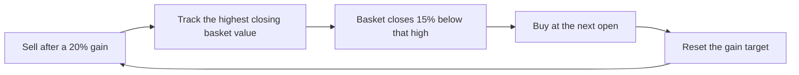
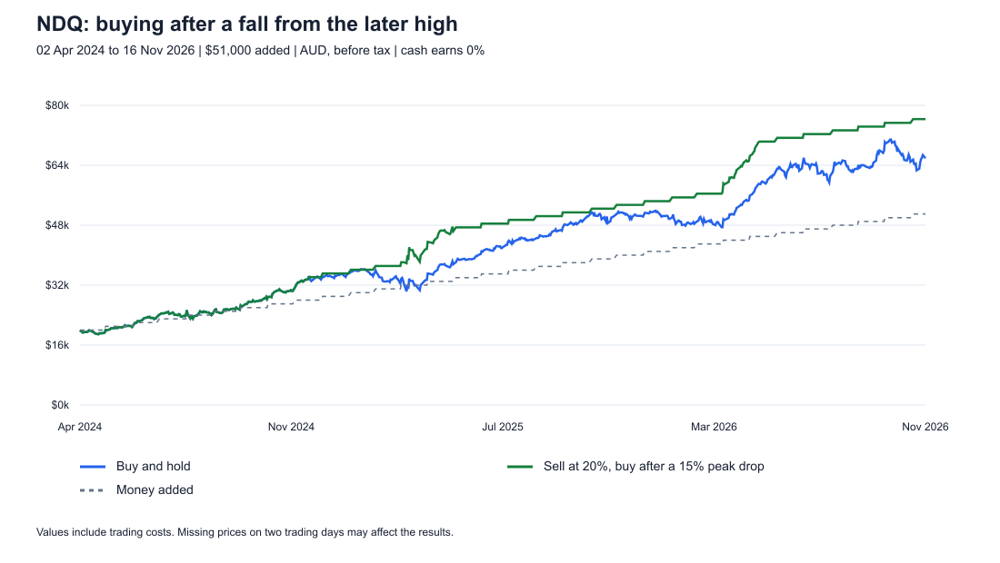

# 3. Buy after a fall from the later high

> **TL;DR:** this rule gave NDQ more chances to buy back. It ended ahead of holding from April 2024, but behind holding from May 2023. It did not beat holding across all five portfolios.

[Overview](../../README.md) · [How the tests work](../methodology.md) · [Run the project](../running.md)

## What changed?

Keep the 20% profit target. After selling, follow the highest **closing** value reached by the sold basket. Buy back after a 15% fall from that high. The next 20% target resets after buying.



**Example, ignoring costs and distributions:** sell at 120, watch the basket rise to 160, then buy after it closes at 136 or below. That is a higher price than the sale. The rule buys a fall from the later high; it does not promise a cheaper price than you sold at.

The peak starts at the exit day's close. Later distributions and split changes are included in the reference basket. Its distributions are only used for the signal and are never added to the real cash account.

## Results once all portfolios had enough trend history

**2 April 2024 to 16 November 2026. A$51,000 added per account. Cash earns 0%.** This is the same start used to compare the trend strategy.



| Portfolio | Hold | Peak-drop rule | Hold: biggest fall | Rule: biggest fall | Times bought back |
| --- | --- | --- | --- | --- | --- |
| NDQ | $65,879 | $76,323 | -21.4% | -10.9% | 2 |
| VAS / VGS (30/70) | $62,696 | $58,858 | -13.6% | -13.6% | 0 |
| A200 / BGBL (30/70) | $63,279 | $58,829 | -13.6% | -13.6% | 0 |
| A200 / BGBL / NDQ (20/50/30) | $64,055 | $58,620 | -15.8% | -15.8% | 0 |
| BGBL / NDQ (70/30) | $65,252 | $57,822 | -16.0% | -16.0% | 0 |

Values are AUD, before tax, after trading costs and estimated selling costs at the end. The biggest fall is adjusted for deposits, and is not a limit on future losses.

### NDQ's result changed with the starting date

Both tests finish on 16 November 2026. Each starts fresh with A$20,000 and then adds A$1,000 a month. Do not compare the raw balances across rows without accounting for the different dates and deposits.

| Start | Money added | Hold | Peak-drop rule | Rule minus hold |
| --- | --- | --- | --- | --- |
| 2023-05-12 | $62,000 | $96,362 | $91,234 | -$5,128 |
| 2024-04-02 | $51,000 | $65,879 | $76,323 | +$10,444 |

### NDQ from April 2024, in more detail

| Rule | Profit | Annual return* | Biggest fall | Sales | Times bought back | Days in cash |
| --- | --- | --- | --- | --- | --- | --- |
| Hold | $14,879 | 14.7% | -21.4% | 0 | 0 | 0 |
| 15% below sale | $13,417 | 13.4% | -10.9% | 2 | 1 | 645 |
| 15% below later high | $25,323 | 23.8% | -10.9% | 3 | 2 | 603 |

*Annual return is money-weighted, so it accounts for when deposits were made.*

## What to take from this

The later-high rule solved one problem with the fixed-sale rule: it allowed buying back even after prices had moved above the old sale value. It also brought new risks. You can pay more than you sold for, buy before a decline is over, or miss gains while waiting.

The 20% target still offers no protection before it is reached. In this test, NDQ was the only April 2024 portfolio where this rule finished ahead of holding. That is worth studying further, but it is not enough to call the rule a rule we can rely on.

**Keep in mind:** two missing trading days may change signals, trade dates and the biggest recorded fall. Results are before tax. They do not tell us what markets will do next.

## Check the details

[Full saved comparison](../../results/tactical/report.md) · [Every account](../../results/tactical/trials.csv) · [Trade log](../../results/tactical/trade_ledger.csv) · [Buying and selling rounds](../../results/tactical/cycles.csv) · [Validation](../../results/tactical/independent_validation.json)

```sh
python3 -m etf_backtest tactical
python3 -m etf_backtest validate-tactical
```

[Next: the 10-month trend rule](../04-monthly-trend/README.md)
