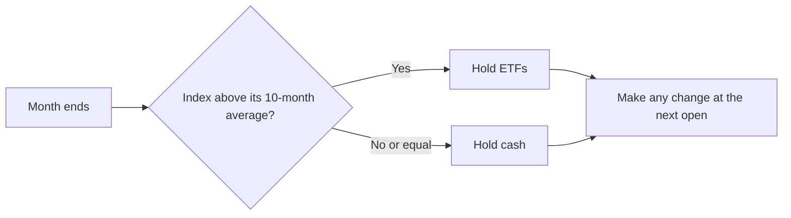
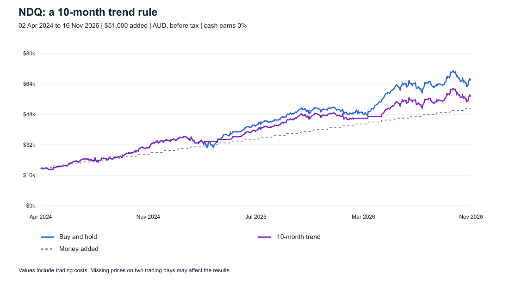

# 4. Follow the 10-month trend

> **TL;DR:** this rule ended with less money than holding in all five portfolios in both shared periods. It reduced the biggest falls in some portfolios, but it could also sell late and miss part of a recovery.

[Overview](../../README.md) · [How the tests work](../methodology.md) · [Run the project](../running.md)

## The rule

At each completed month-end, compare a portfolio index with its average over the last ten month-ends.



There is **no 20% profit target** here. The account can keep holding through a long rise. Deposits continue in cash when it is out of shares.

The index is built from actual ETF returns, including distributions and split changes. It is reset to the target weights each month. It is a signal, not the value of the real account. The real account still pays costs, buys whole units and receives distributions on their payment dates. [How the signal is built](../methodology.md#the-trend-signal).

## Compare accounts with enough starting history

**2 April 2024 to 16 November 2026. A$51,000 added per account. Cash earns 0%.**



| Portfolio | Hold | 10-month trend | Hold: biggest fall | Trend: biggest fall | Sales |
| --- | --- | --- | --- | --- | --- |
| NDQ | $65,879 | $57,438 | -21.4% | -13.4% | 2 |
| VAS / VGS (30/70) | $62,696 | $57,032 | -13.6% | -13.6% | 2 |
| A200 / BGBL (30/70) | $63,279 | $57,165 | -13.6% | -13.6% | 2 |
| A200 / BGBL / NDQ (20/50/30) | $64,055 | $59,815 | -15.8% | -8.8% | 2 |
| BGBL / NDQ (70/30) | $65,252 | $60,285 | -16.0% | -16.0% | 2 |

Values are AUD, before tax, after trading costs and estimated selling costs at the end. The biggest fall is adjusted for deposits.

### NDQ in more detail

| Rule | Profit | Annual return* | Biggest fall | Times invested | Sales | Days in cash |
| --- | --- | --- | --- | --- | --- | --- |
| Hold | $14,879 | 14.7% | -21.4% | 1 | 0 | 0 |
| 10-month trend | $6,438 | 6.7% | -13.4% | 3 | 2 | 122 |

*Annual return accounts for the dates of deposits. Times invested includes the first purchase; times bought back does not.*

## Why we also use a later start

The original comparison starts on **12 May 2023**. Funds using BGBL did not have ten complete monthly observations yet, so the trend accounts waited in cash. We did not invent earlier ETF prices to fill the gap.

| Portfolio | First date with enough signal history | Days waiting for history from May 2023 |
| --- | --- | --- |
| NDQ | 2016-05-02 | 0 |
| VAS / VGS (30/70) | 2015-11-02 | 0 |
| A200 / BGBL (30/70) | 2024-04-02 | 326 |
| A200 / BGBL / NDQ (20/50/30) | 2024-04-02 | 326 |
| BGBL / NDQ (70/30) | 2024-04-02 | 326 |

The April 2024 comparison starts every account fresh after all five portfolios have enough history. It does not carry earlier gains forward. Both starts are in the saved results, and the trend rule finished below holding in each.

A missing VGS quote on 31 December 2014 also removes that month-end from the earlier signal history. The lookback restarts after that gap. [Data limits](../methodology.md#missing-data).

## What to take from this

A monthly signal reacts after a move has happened. During a sharp fall it can sell late; during a fast recovery it can buy back late. Sideways markets can lead to repeated changes and extra costs.

Smaller losses can still be useful, even with a lower ending balance. Here, that benefit varied by portfolio. The results do not make a case that this exact rule is a better overall choice than holding.

These are simple research rules. They do not copy a named fund manager's strategy.

**Keep in mind:** two missing trading days may change signals, trade dates and the biggest recorded fall. Results are before tax. They do not tell us what markets will do next.

## Check the details

[Full saved comparison](../../results/tactical/report.md) · [Every account](../../results/tactical/trials.csv) · [Month-end signals](../../results/tactical/trend_history.csv) · [Other start dates](../../results/tactical/summary.csv) · [Validation](../../results/tactical/independent_validation.json)

```sh
python3 -m etf_backtest tactical
python3 -m etf_backtest validate-tactical
```

[Back to the overview](../../README.md)
